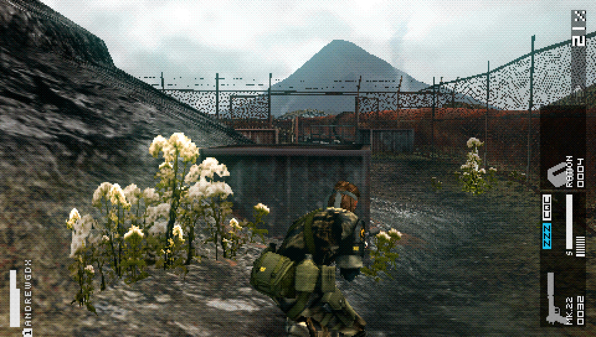
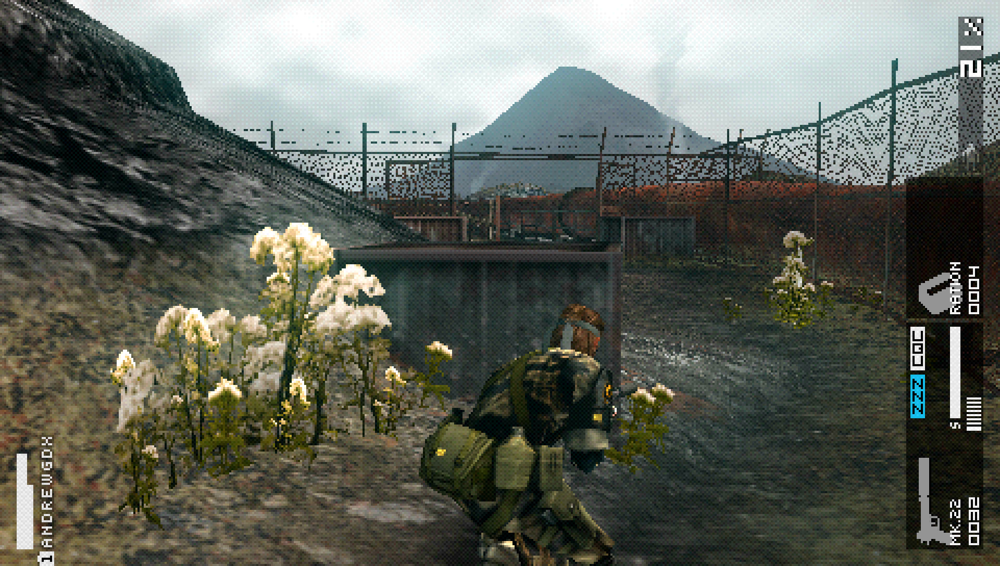
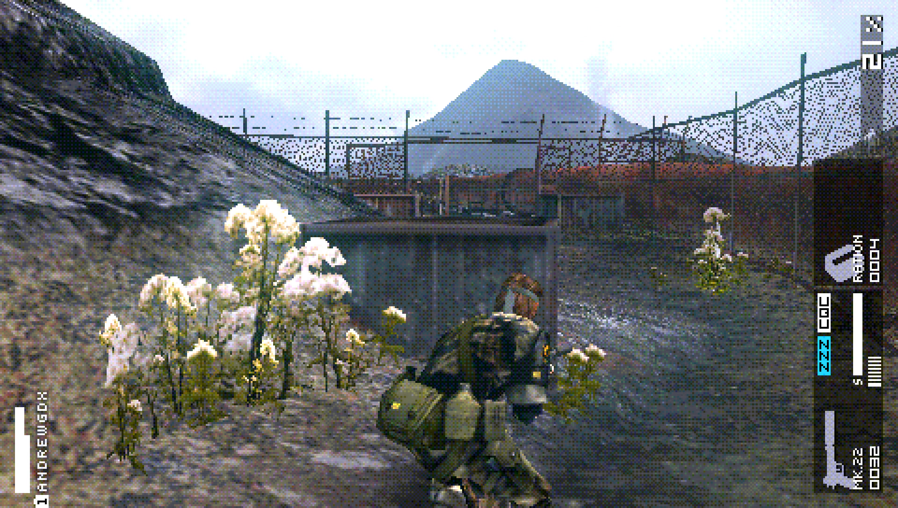

# PSP Hardware Dithering for PPSSPP

A post-processing shader for [PPSSPP](https://www.ppsspp.org/) that recreates the PSP's
16-bit framebuffer and GE dithering **while staying on the hardware renderer**, so you keep
the speed and high internal resolution and still get the image the PSP actually produced.

On a real PSP most games render into a 16-bit framebuffer (5551 or 565) with the GE's 4x4
dither matrix turned on. That is where the characteristic fine cross-hatch and soft
gradients come from. PPSSPP's hardware renderer draws in full 32-bit color and skips the
dither, so gradients come out banding-free but "too clean", and dark scenes and fog look
different from the original. The software renderer gets it right, but it is slow and
limited to native resolution.

This shader goes after rendering and repeats the GE's framebuffer write for every pixel:

1. add the signed 4x4 dither matrix value to the 8-bit color (the SDK default matrix
   nearly every game loads),
2. clamp and truncate to the framebuffer format (565 / 5551 / 4444 / 332),
3. expand back to 8 bits with bit replication, like the PSP display controller.

The dither pattern stays locked to the PSP's 480x272 pixel grid, so at 2x+ rendering the
geometry stays sharp and high-res while the dither keeps its original, chunky look.

## Comparison

Metal Gear Solid: Peace Walker at 1x rendering resolution, upscaled 4x with nearest
neighbour (click an image for full size).

| Hardware renderer, no shader | Software renderer (reference) |
|---|---|
|  |  |
| **Hardware renderer + PSP Hardware Dithering 5551** | **Hardware renderer + PSP Hardware Dithering 332** |
|  |  |

The software renderer runs the real GE dithering. The 5551 preset gets close to it while
keeping the speed of the hardware renderer, and unlike the software renderer it still works
at higher rendering resolutions.

## Features

- PSP GE dither matrix, plus a "written twice" mode for games that finish the frame with a
  dithered full-screen pass (e.g. MGS Peace Walker's bloom), which darkens dark areas and
  coarsens the cross-hatch the way it does on hardware
- Framebuffer formats: 8888, 565, 5551, 4444, 332
- Dither on the PSP pixel grid at high render resolution, or native 480x272 output
  (supersampled or point sampled)
- Optional dither-only blur: softens the dither pattern without blurring edges or textures,
  imitating how it looked on the PSP's LCD
- Pixel-exact final scaling, so dither cells never smear at non-integer window sizes
- FMVs are never dithered, like on hardware
- Handles rotated displays and stereo (side-by-side / top-and-bottom) output
- Plain GLSL with no arrays, should work on all of PPSSPP's backends (OpenGL, Vulkan, D3D)

## Installation

1. Copy these files into PPSSPP's `shaders` folder:
   - `psp_hardware_dithering.ini`
   - `psp_hardware_dithering.fsh`
   - `psp_hardware_dithering_scale.fsh`
   - `psp_hardware_dithering.vsh`

   | Platform | Folder |
   |---|---|
   | Windows | `<PPSSPP folder>\memstick\PSP\shaders\` (or `Documents\PPSSPP\PSP\shaders\`) |
   | macOS / Linux | `~/.config/ppsspp/PSP/shaders/` |
   | Android | `<storage>/PSP/shaders/` |

   Create the folder if it does not exist.
2. Restart PPSSPP.
3. Settings → Graphics:
   - **Backend / renderer**: any hardware backend (software rendering is not needed)
   - **Rendering resolution**: 2x or higher recommended
   - **Postprocessing shaders**: add **PSP Hardware Dithering 5551** (or **332**). Put it
     **last** in the chain. Color shaders (Natural Colors, PSP Color, ...) can go before it.

## Presets

| Preset | Default format | Default dither | Default blur |
|---|---|---|---|
| PSP Hardware Dithering 5551 | 5551 | PSP GE matrix x2 | 0.40 |
| PSP Hardware Dithering 332 | 332 | Bayer 4x4 | 0.65 |

Every setting can be changed from PPSSPP's shader settings, so either preset can be turned
into any combination. If a game looks too dark or too coarse, try switching the dither from
`PSP x2` to `PSP x1`. Many games, but not all, use the dithered full-screen pass.

## Settings

| Setting | Values |
|---|---|
| Color depth | 0 = 32-bit 8888, 1 = 16-bit 565, 2 = 15-bit 5551, 3 = 12-bit 4444, 4 = 8-bit 332 |
| Dither | 0 = off (truncate only), 1 = PSP GE matrix, 2 = PSP GE matrix written twice, 3 = Bayer 2x2, 4 = Bayer 4x4 |
| Pixels | 0 = hi-res, dither on PSP grid · 1 = hi-res, dither on render grid · 2 = native 480x272 supersampled · 3 = native 480x272 supersampled, dither on render grid · 4 = native 480x272 point sampled |
| Dither blur | 0–1 for a Gaussian radius of 0–1.5 PSP pixels, applied to the dither error only (0 = off) |

## How it works

Each preset is two passes:

- **Pass 1** (`psp_hardware_dithering.fsh`, hidden) runs at render resolution. It works out
  the real render scale and PSP buffer size from the texture coordinates (PPSSPP's reported
  texel size is too large for games that display less than their buffer holds), emulates
  the GE framebuffer write, and applies the optional dither blur. It stores its own output
  size in the alpha channel for pass 2.
- **Pass 2** (`psp_hardware_dithering_scale.fsh`) scales the result to the screen using the
  nearest texel, blending only the boundary texels by the exact area each output pixel
  covers, so the dither stays crisp at any window size.

The GE matrix used is the SDK default:

```
-4  0 -3  1
 2 -2  3 -1
-3  1 -4  0
 3 -1  2 -2
```

## Limitations

- This is a post-process approximation: it dithers the finished 32-bit frame once (or
  twice), while the real GE dithers every primitive as it is blended. Scenes with heavy
  alpha blending can differ slightly from the software renderer.
- Games that change the dither matrix or turn dithering off for some draws are not
  detected. The shader applies the same matrix everywhere except during FMVs.

## License

Public domain, released under [the Unlicense](LICENSE). Use, copy, modify, redistribute,
sell, or bundle it (in PPSSPP or anywhere else) however you want, with or without credit.
